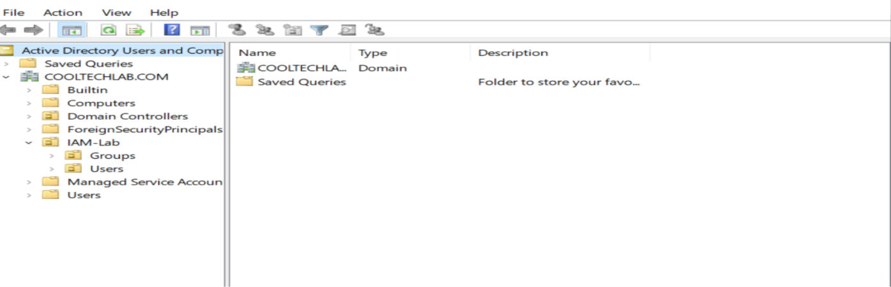
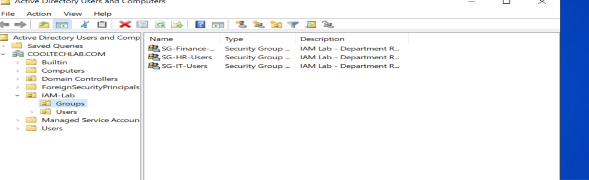
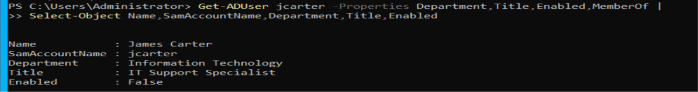
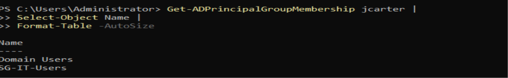
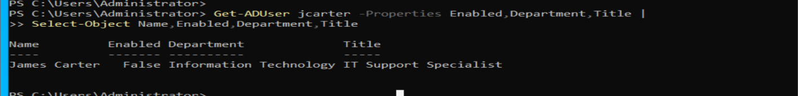
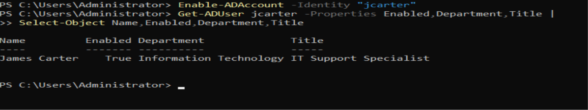
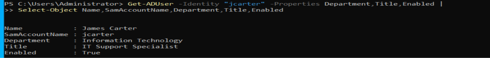
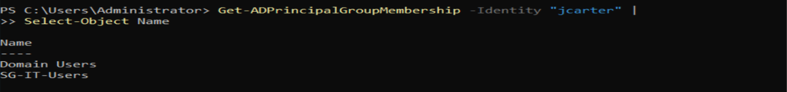
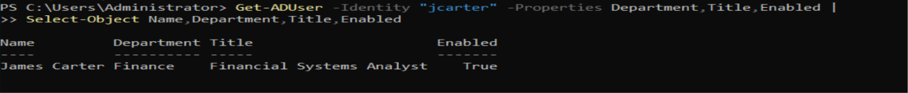
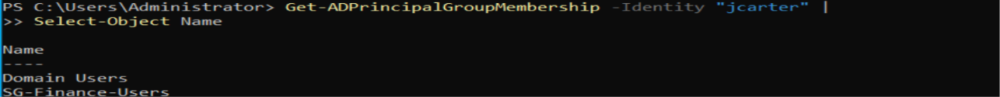

# Identity Lifecycle Management | Joiner, Mover, Leaver (JML)

**Hands-on IAM Security Analyst portfolio lab** · Active Directory · PowerShell · RBAC · Least Privilege

> **Lab status:** Joiner, Mover, and Leaver AD account/group validations documented. Leaver screenshots are pending. This is a simulated business scenario using fictional identities, not production employment experience.

## Business context

CoolTech Lab is a fictional organization. A simulated onboarding request (**IAM-JML-001**) asks the IAM analyst to provision **James Carter** (`jcarter`) as an IT Support Specialist, assign the standard IT departmental security group, and verify the resulting identity configuration.

## Lab environment

- **Directory:** `COOLTECHLAB.COM`
- **Server:** Windows Server 2022 Datacenter Evaluation, running Active Directory Domain Services
- **Tools:** Active Directory Users and Computers (ADUC), Windows PowerShell ActiveDirectory module
- **Scope:** On-premises AD only. **Microsoft Entra Connect Sync is not installed**; this project does not claim hybrid synchronization.

## Directory design

```text
DC=COOLTECHLAB,DC=COM
└── OU=IAM-Lab
    ├── OU=Users
    └── OU=Groups
        ├── SG-IT-Users
        ├── SG-HR-Users
        └── SG-Finance-Users
```

These are **departmental security groups**, not proof of access to a specific application or file share. Resource permissions have not yet been demonstrated.

## IAM-JML-001 — Joiner

| Field | Simulated request |
| --- | --- |
| Employee | James Carter (fictional) |
| Username | `jcarter` |
| Department | Information Technology |
| Title | IT Support Specialist |
| Intended group | `SG-IT-Users` |
| Approval | Simulated for lab purposes; no real ticketing approval system |

### Implementation and validation

The lab created the `IAM-Lab` organizational structure and three departmental security groups. The `jcarter` identity was provisioned with IT department attributes and assigned to `SG-IT-Users`.

Observed PowerShell group membership: `Domain Users`, `SG-IT-Users`. No HR or Finance group appeared in that output.

### Post-provisioning finding: disabled account

The first post-provisioning query returned `Enabled = False`, despite the requested onboarding state being enabled. This would prevent normal authentication with the account.

**Corrective action performed:**

```powershell
Enable-ADAccount -Identity "jcarter"
```

**Verified outcome:** A second `Get-ADUser` query returned `Enabled = True`, while the department remained **Information Technology** and title remained **IT Support Specialist**.

**Limits of evidence:** The reason the account was initially disabled was not determined. Successful interactive sign-in was not tested in the provided evidence. The earlier group-membership output was not repeated after remediation, so the after-state group membership should be rechecked.

See [Joiner case study](docs/IAM-JML-001-joiner.md) and [validation commands](scripts/validation-commands.ps1).

## IAM-JML-002 — Mover (IT to Finance)

The fictional employee `jcarter` was transferred from **Information Technology / IT Support Specialist** to **Finance / Financial Systems Analyst**. Post-change PowerShell output confirmed `Enabled = True` and group membership of `Domain Users` and `SG-Finance-Users`, with no `SG-IT-Users` reported. This verifies the AD group transition, not downstream application permissions.

See the [Mover case study](docs/IAM-JML-002-mover.md). The four Mover before-and-after screenshots have been uploaded and linked below.

## IAM-JML-003 — Leaver (Offboarding)

The fictional employee `jcarter` was offboarded in the on-premises AD lab. Post-change PowerShell output verified that the account was **disabled** (`Enabled = False`), the Finance departmental security group was **absent**, and `Domain Users` remained. The account record was retained.

See the [Leaver case study](docs/IAM-JML-003-leaver.md). Screenshot evidence is pending upload. Existing sessions and application-specific permissions were not tested.

## Screenshot evidence

The following screenshots are uploaded from the lab:

### Active Directory organizational units


### Departmental security groups


### Joiner provisioning


### Initial group-membership validation


### Initial account-status finding: disabled before corrective action


### Account-status remediation: enabled after corrective action


**Evidence status:** Both the initial disabled-account state (`Enabled = False`) and the corrected enabled-account state (`Enabled = True`) are documented with screenshots.

## Mover screenshot evidence

### Before — account attributes


### Before — group membership


### After — account attributes


### After — group membership


## Project roadmap

- [x] Create IAM lab OUs and departmental security groups
- [x] Provision fictional Joiner account
- [x] Detect disabled account and verify remediation
- [x] Upload Joiner lab screenshots
- [ ] Recheck post-remediation group membership
- [x] Mover: transfer IT to Finance and validate AD group change
- [x] Upload Mover before/after screenshots
- [ ] Perform resource-level authorization checks
- [x] Leaver: disable AD account, remove Finance group, and validate AD state
- [ ] Upload Leaver before/after screenshots
- [ ] Entra ID cloud-only extension (separate identities; no synchronization claimed)

## Security takeaways

- Validate identity state after provisioning rather than assuming success.
- Use departmental group membership as a basis for least-privilege administration, then separately verify actual resource permissions.
- Record both the initial failure and corrected state.
- Distinguish observed facts from assumptions about root cause and approval.

**Disclaimer:** Fictional identities, simulated service requests, and lab-only systems. No production access or enterprise ticket approvals are claimed.
