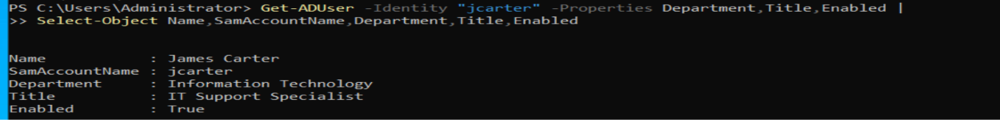
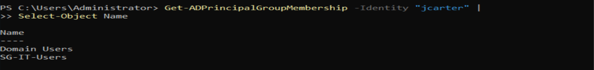
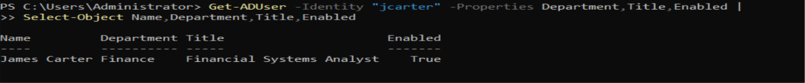

# IAM-JML-002 — Mover: IT to Finance

**Scenario:** Simulated internal employee transfer | **Account:** James Carter (`jcarter`) | **Directory:** `COOLTECHLAB.COM`

> This is a lab simulation. Manager authorization is assumed for the exercise, not verified through a production ticketing system.

## Request and intended change

Transfer an existing employee from **Information Technology / IT Support Specialist** to **Finance / Financial Systems Analyst**. Retain the existing identity and enabled status, remove obsolete IT departmental membership, and grant Finance departmental membership.

## Pre-change baseline (PowerShell)

| Attribute | Observed |
| --- | --- |
| Name / username | James Carter / `jcarter` |
| Department | Information Technology |
| Title | IT Support Specialist |
| Enabled | True |
| Group membership | `Domain Users`, `SG-IT-Users` |

## Lab change procedure

The following commands were supplied for the simulated transfer:

```powershell
Set-ADUser -Identity "jcarter" -Department "Finance" -Title "Financial Systems Analyst"
Remove-ADGroupMember -Identity "SG-IT-Users" -Members "jcarter" -Confirm:$false
Add-ADGroupMember -Identity "SG-Finance-Users" -Members "jcarter"
```

The user reported the post-change validation output below. This supports the resulting configuration; it does not independently establish an execution log for each command.

## Post-change validation (observed)

```text
Name         Department Title                     Enabled
----         ---------- -----                     -------
James Carter Finance    Financial Systems Analyst True

Name
----
Domain Users
SG-Finance-Users
```

**Result:** The account remains enabled, the department and title reflect the Finance role, `SG-Finance-Users` is present, and `SG-IT-Users` is absent from the returned group-membership list.

## Security interpretation

The departmental RBAC assignment changed as intended, and stale IT group membership is no longer reported. This **does not by itself prove** that every IT resource permission was revoked or that Finance application access works. Those require separate resource-level testing.

## Evidence checklist

- [x] `screenshots/07-mover-before-user-attributes.png`
- [x] `screenshots/08-mover-before-group-membership.png`
- [x] `screenshots/09-mover-after-user-attributes.png`
- [x] `screenshots/10-mover-after-group-membership.png`

All four screenshot filenames were verified in GitHub.

## Outcome

**AD identity and group validation: Passed.** Screenshot files uploaded; resource-level authorization tests remain pending.

## Screenshot gallery








